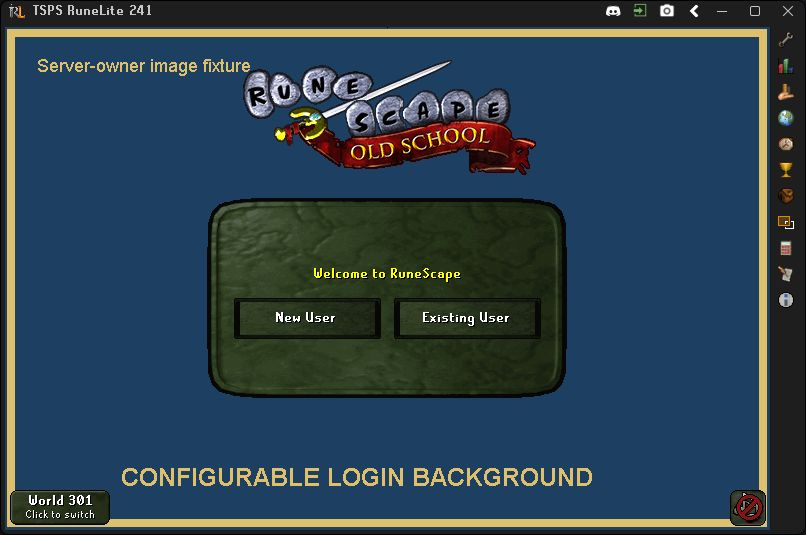
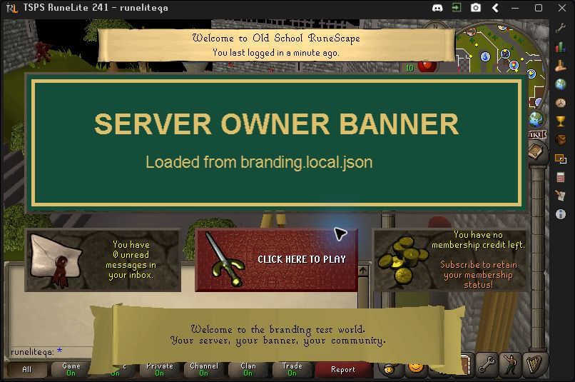
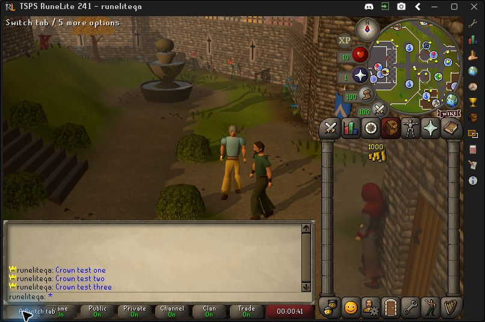
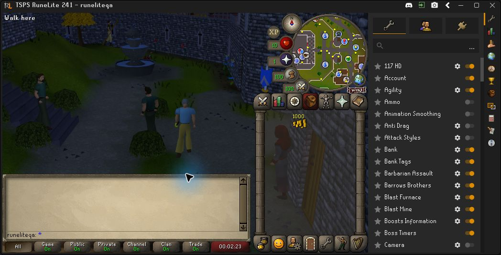

# Experimental RuneLite gateway

Run genuine RuneLite 1.13.3 (native revision 241) against an isolated TSPS world. A local RSProt JVM gateway translates RuneLite's TCP protocol into TSPS's existing WebSocket protocol. TSPS remains authoritative for authentication, gameplay and persistence.

**117 HD is optional.** Normal preparation and launch do not require or download it. This is a developer setup for Windows, with one native connection at a time; it is not a packaged player launcher or complete content compatibility.

## Prerequisites

- A working TSPS checkout, Node 22+, PowerShell 7 and Git Bash for the repository's worktree script.
- JDK 21; set `JAVA_HOME` to its installation directory in each PowerShell terminal, or pass `-JavaHome` to the PowerShell scripts.
- The revision 241 cache `server/caches/osrs-241_2026-10-20`, including its map keys. The worktree helper copies the cache and dependencies from your existing checkout. Run normal repository setup if these are missing.
- Internet access on first preparation/build for pinned RuneLite, RSProx, Gradle and Maven artifacts. Downloaded/patched binaries are stored locally, not included in this PR.

## Create an isolated worktree

From your normal TSPS checkout in Git Bash:

```bash
git fetch https://github.com/UnhealthyKraken/tsps.git feat/runelite-gateway
gateway_commit=$(git rev-parse FETCH_HEAD)
scripts/wt new test/runelite-gateway "$gateway_commit"
cd ../tsps-test-runelite-gateway
```

The immutable commit is captured before the helper fetches upstream. Use a fresh test branch name if `test/runelite-gateway` already exists.

`scripts/wt` assigns a slot and private ports in `.env`. Its copied cache, dependencies and separate `server/data` keep this experiment away from your installed world. Use a new account here. Do not copy or link your live player database into it.

Open three PowerShell terminals in the new worktree. In the gateway and client terminals, calculate the assigned ports:

```powershell
$slot = [int](Select-String -Path .env -Pattern '^WT_SLOT=(\d+)$').Matches.Groups[1].Value
$wsPort = 43700 + $slot
$gamePort = 43800 + $slot
$httpPort = 43900 + $slot
```

## Start TSPS

First terminal:

```powershell
# Build once when server source changed or dist is absent:
node server/node_modules/typescript/bin/tsc --build server
node tools/runelite-gateway/serve-tsps.cjs
```

The launcher enables the opt-in snapshot plugin, forces worktree-local SQLite/legacy paths and disables legacy import. It refuses an installed main checkout, inconsistent slot, external save links or an occupied game port. It never stops an existing process. `--check` prints the resolved setup without starting the server.

## Start the gateway

Second terminal, with `JAVA_HOME` and the calculated ports:

```powershell
./tools/runelite-gateway/start.ps1 -Build -Port $gamePort -HttpPort $httpPort -Upstream "ws://127.0.0.1:$wsPort"
```

`-Build` is needed initially or after gateway source changes. Subsequent unchanged launches can omit it. TCP and HTTP bind loopback only. The gateway reads this worktree's copied cache and creates a disposable local RSA key; it never opens player saves. Default/live ports 43594/3000/49700 are rejected.

## Prepare and open RuneLite

Third terminal, with `JAVA_HOME` and the calculated ports:

```powershell
./tools/runelite-client/prepare.ps1
./tools/runelite-client/start.ps1 -RsaModulusFile tools/runelite-gateway/.runtime/rsa-modulus.txt -GamePort $gamePort -HttpPort $httpPort
```

Preparation verifies artifact sizes/hashes and the actual injected client revision. Launch patches only these local copies with the gateway's RSA/ports/host and uses a separate client home, cache, configuration and OS environment under `tools/runelite-client/.runtime`. It does not change an installed RuneLite profile. The launcher refuses another client using this private runtime.

Log in with a fresh disposable account. Select **All** or **Public** at the bottom to see public messages; a Game-only chat view can persist between sessions.

### Optional 117 HD

Close the client normally, then in the client terminal:

```powershell
./tools/runelite-client/prepare.ps1 -HD
./tools/runelite-client/start.ps1 -RsaModulusFile tools/runelite-gateway/.runtime/rsa-modulus.txt -GamePort $gamePort -HttpPort $httpPort -HD
```

Enable **117 HD** in RuneLite's configuration list on first use. Core GPU and 117 HD are mutually exclusive; RuneLite may require switching from GPU through this toggle. The renderer is pinned to 117 HD 1.6.0, verified against the signed RuneLite 1.13.3 Plugin Hub manifest. Omit `-HD` to use the standard client again.

## Server branding (optional)

Server owners can independently replace the middle welcome-screen banner, the bottom parchment text, and the username/password screen's background. This works with the standard client; 117 HD is not involved.

Copy the template and edit the local copy:

```powershell
Copy-Item tools/runelite-gateway/branding.example.json tools/runelite-gateway/branding.local.json
```

The template uses `null` for all three settings, preserving the stock screen. For example, after adding your images:

```json
{
  "welcomeText": "Welcome to our server!\nNews and events: discord.gg/example",
  "welcomeBanner": "branding-assets/welcome-banner.png",
  "loginBackground": "branding-assets/login-background.jpg"
}
```

- Paths are relative to the JSON file. Place the example images under `tools/runelite-gateway/branding-assets/`. The local config and this asset directory are ignored by Git.
- Use PNG or JPEG, at most 8 MiB per image, with each dimension at most 4096 pixels. Files and links must stay inside the config's directory. The gateway refuses invalid configuration at startup with an error.
- A banner around **700 x 190** pixels fits the welcome panel. It is fitted inside the existing border without stretching. The loading rune animation is hidden only when a custom banner is available.
- A background around **765 x 503** pixels matches the native login canvas. Other proportions are scaled and cropped to fill it.
- Bottom text is plain text, up to 400 characters. Use `\n` for new lines; three or four short lines fit the parchment best. Markup is displayed literally.
- Leave any setting `null` or omit it to keep that stock element. The client keeps the stock element if its branding fetch fails; branding does not block normal login.
- Restart the gateway and RuneLite after changing config/images; **no rebuild is required**. The gateway serves the selected files to the client over its existing loopback HTTP port, so no separate web host is needed.
- To keep the config elsewhere, pass `-BrandingFile path/to/branding.json` to the gateway launcher. Resolve image paths relative to that file as usual.

The pictured post-login welcome interface and the pre-login background are separate screens. Branding preserves the native Play button and login flow; it does not patch the game's cache or installed RuneLite profile.

These native screenshots use diagnostic example artwork, with 117 HD off:





## Stop

Log out normally and close RuneLite. Stop the gateway terminal, then stop TSPS and wait for `[shutdown] Player persistence completed.` Do not use an installed world's stop script.

## Verified behavior and limits

- Native cache/scene loading and normal TSPS account login; ground/minimap movement; inventory/equipment display and wielding; real NPC Talk-to and dialogue continuation; public chat with the crown before the name; normal logout and saved-position relog.
- These checks used a separate TSPS world and disposable account. Sword/coins and an NPC were controlled QA fixtures, not acquisition tests.
- Branding QA without117HD: custom login background and welcome banner/footer rendered from config; disabling restored stock artwork/loader/footer, re-enabling and relog reapplied branding, and native Play/logout worked. Six gateway tests and31 client transport/lifecycle checks cover the new paths; no full-suite rerun.
- Three actual keyboard-submitted public messages rendered once each. Native diagnostics also confirmed the chat entry and overhead text. Optional 117 HD rendered the same TSPS world on an RTX 5090; startup alone was not counted as scene verification.
- Focused checks cover observer-filtered snapshots, private-instance visibility/removal, unchanged normal binary packets, fail-closed oversize snapshots, real cache/JS5/Huffman, native inputs, UI/inventory/stat translation, serialized WebSocket writes, chat bursts/index reuse and launcher save isolation. See tool READMEs for commands and pins. No full repository suite was run.
- Compatibility remains incomplete for shops, trade, custom interfaces, dynamic objects/ground items, instances and Sailing. Actor forced movement/custom models and broader remote-chat scenarios need further work. One native connection is supported; login does not establish all-content or gameplay parity.
- Native cache bounds omit browser-only overlay varps 7995-7999 and absent legacy 317 widgets. They cannot be forwarded directly to the native client.





## Implementation and troubleshooting

- [Gateway](../tools/runelite-gateway/README.md): RSProt version, cache/framing details, configuration and focused checks.
- [Client launcher](../tools/runelite-client/README.md): RuneLite/RSProx/renderer pins, signature verification and private runtime.
- `-TraceInput` on the gateway and `-Diagnostics` on the client enable opt-in debugging; public/game chat text can appear in local logs. Normal launches leave these off. Do not publish private runtime keys, account databases or logs.
